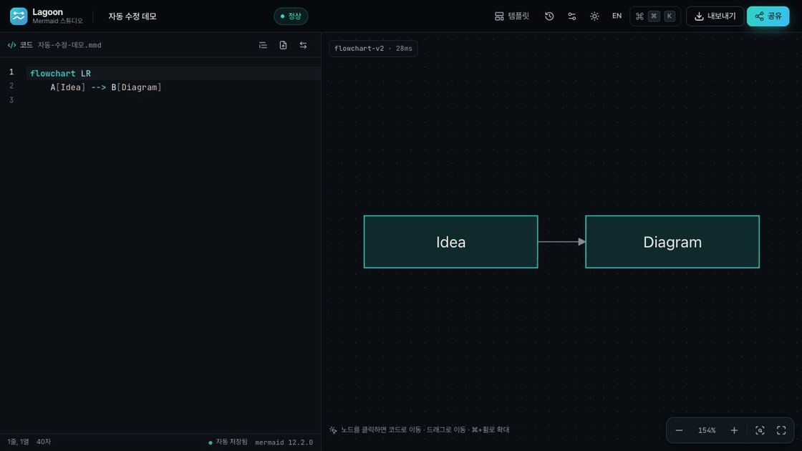
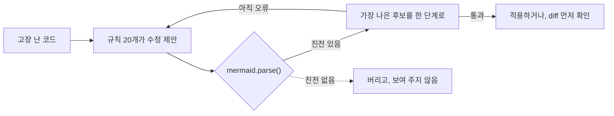
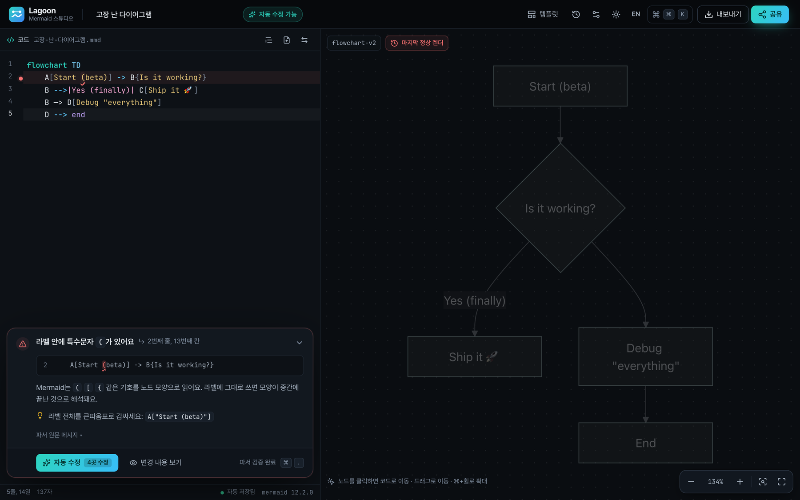
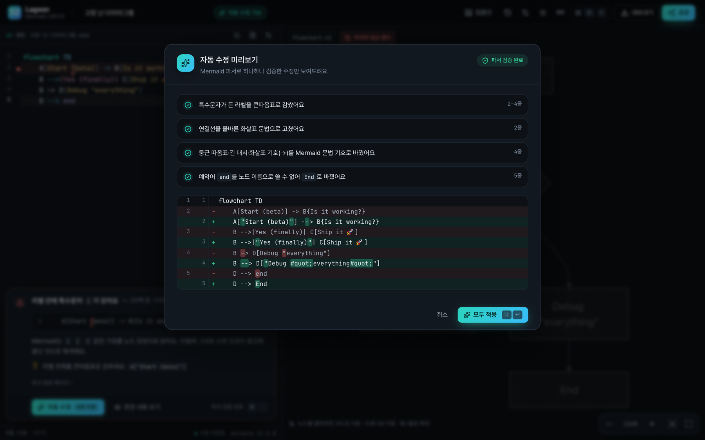
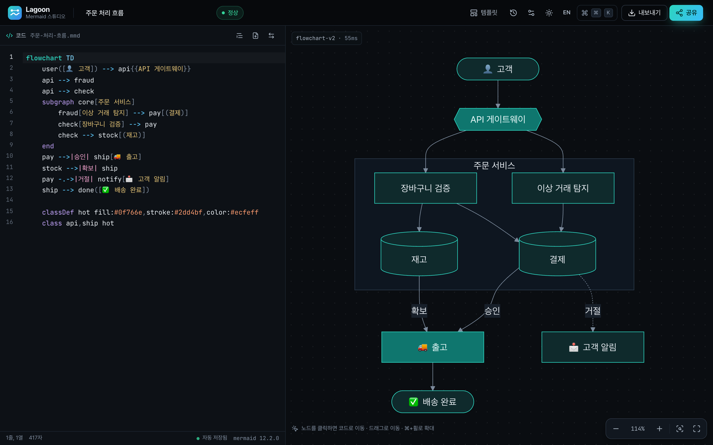
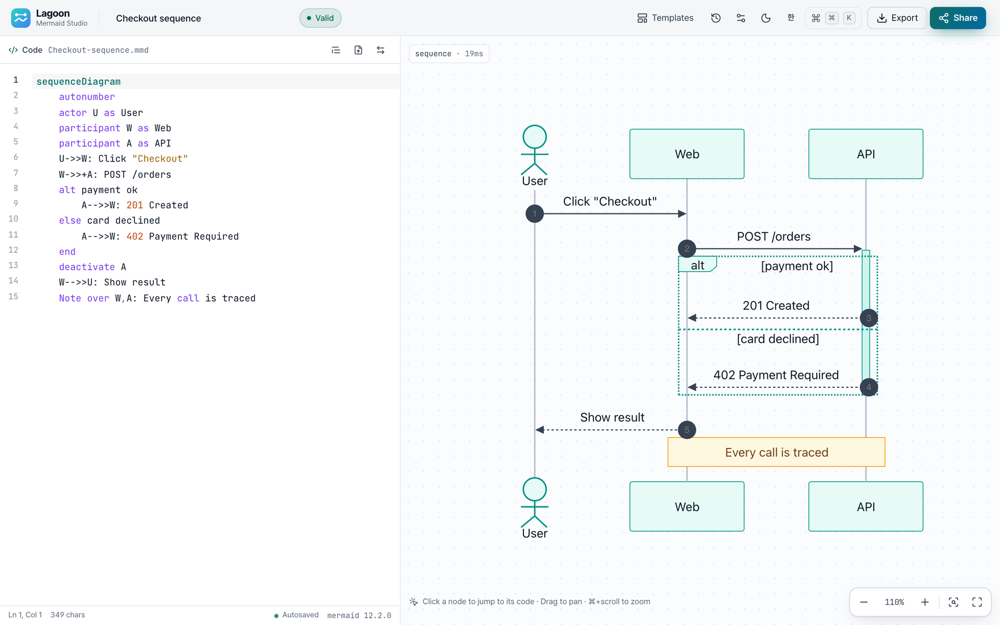
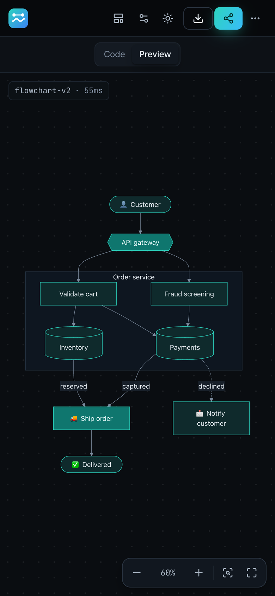
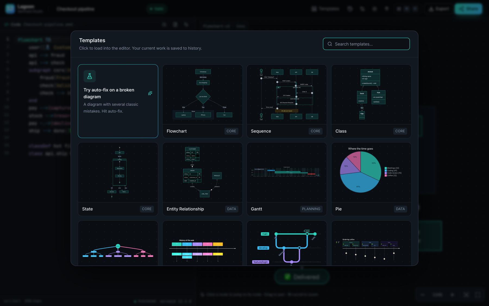

<div align="center">

<a href="https://lagoon-mermaid.vercel.app"></a>

### 안 그려지던 Mermaid, 클릭 한 번이면 그려져요.

무엇이 틀렸는지 쉬운 말로 짚어 주고, 실제 Mermaid 파서를 통과한 수정만 내놓아요.<br>가입도 API 키도 필요 없고, 다이어그램은 브라우저 밖으로 나가지 않아요.

**[바로 써 보기 →](https://lagoon-mermaid.vercel.app)** &nbsp;&nbsp;·&nbsp;&nbsp; **[자동 수정 원리](#자동-수정은-이렇게-동작해요)** &nbsp;&nbsp;·&nbsp;&nbsp; **[고칠 수 있는 실수](#고칠-수-있는-실수)** &nbsp;&nbsp;·&nbsp;&nbsp; **[English](README.md)**

[](https://lagoon-mermaid.vercel.app) [](https://github.com/mermaid-js/mermaid) <br>  

<br>

<a href="https://lagoon-mermaid.vercel.app"> 와 —> 화살표, end 노드가 섞인 다이어그램을 붙여 넣으면 흐려진 마지막 렌더 위로 오류 카드가 뜨고, 자동 수정 · 6곳 수정을 누르면 '6곳을 고쳤어요 · ⌘Z' 알림과 함께 다이어그램이 그려져요. 노드를 클릭하면 해당 코드 줄이 강조돼요."></a>

<sub>고장 난 다이어그램 붙여 넣기 &nbsp;→&nbsp; 무엇이 틀렸는지 확인 &nbsp;→&nbsp; <b>자동 수정 · 6곳 수정</b> &nbsp;→&nbsp; <i>6곳을 고쳤어요 · ⌘Z</i> &nbsp;→&nbsp; 노드를 클릭하면 그 코드 줄로</sub>

</div>

<br>

## 자동 수정은 이렇게 동작해요

데모에서 붙여 넣은 다이어그램을 그대로 옮겨 왔어요. 버튼 한 번이면 여섯 곳이 한꺼번에 고쳐져요.

````diff
- ```mermaid
- graph TOP
+ graph TD
-     A[Start (beta)] -> B{Is it working?}
+     A["Start (beta)"] --> B{Is it working?}
-     B -->|Yes (finally)| C[Ship it 🚀]
+     B -->|"Yes (finally)"| C[Ship it 🚀]
-     B —> D[Debug "everything"]
+     B --> D["Debug #quot;everything#quot;"]
-     D --> end
+     D --> End
- ```
````

<sub>네, 안쪽 큰따옴표는 <code>#quot;</code>로 바뀌어요. Mermaid가 원래 쓰는 이스케이프라서 라벨에는 그대로 <i>Debug "everything"</i>으로 보여요.</sub>

모델도 없고, 짐작도 없어요. **제안은 규칙이, 판정은 파서가, 적용은 사용자가 해요.** 수정 후보마다 다이어그램을 그리는 바로 그 `mermaid.parse()`로 다시 파싱해서, 오류가 사라졌거나 파서가 파일 안쪽으로 더 나아간 후보만 남겨요.



### 단계마다 오류가 아래로 밀려나요

한 행이 채택된 수정 한 단계이고, 오른쪽 칸은 그 직후 `mermaid.parse()`가 알려 준 내용이에요. 단계를 거칠 때마다 오류 위치가 파일 아래쪽으로 내려가다가 결국 사라져요. (줄 번호는 그 시점의 코드 기준이라, 1단계부터는 펜스 줄을 빼고 세요.)

| 단계 | 규칙 | 수정 | 파서의 다음 응답 |
|:-:|---|---|---|
| | | *붙여 넣은 그대로* | ✗ 1번째 줄 · 마크다운 코드 펜스가 섞여 있어요 |
| 1 | `fences` | `` ``` `` 줄 2개 삭제 | ✗ 1번째 줄, 6번째 칸 · 지원하지 않는 방향이에요: `TOP` |
| 2 | `direction` | `TOP` → `TD` | ✗ 2번째 줄, 13번째 칸 · 라벨 안에 특수문자 `(`가 있어요 |
| 3 | `quote-labels` | 괄호·따옴표가 든 라벨 3개를 큰따옴표로 | ✗ 2번째 줄, 23번째 칸 · 연결선 모양이 올바르지 않아요 |
| 4 | `arrows` | `->` → `-->` | ✗ 4번째 줄, 7번째 칸 · Mermaid가 모르는 문자가 있어요 |
| 5 | `typography` | 긴 대시 `—>` → `-->` | ✗ 5번째 줄, 11번째 칸 · `end`는 예약어예요 |
| 6 | `reserved-end` | `end` → `End` | ✓ 통과 |

<details>
<summary><b>‘파서가 더 멀리 갔다’는 어떻게 재나요</b></summary>

<br>

- **끝에서부터 잰 거리.** 오류 뒤로 아직 파싱되지 않은 분량, 즉 오류 아래 줄 수와 그 줄의 나머지가 점수예요(`engine.ts`의 `remainingAfter()`). 끝에서부터 재기 때문에 오류 *앞에* 글자를 넣는 것(따옴표 추가, 펜스 줄 삭제)만으로는 진전으로 치지 않아요.
- **닫히지 않은 구문.** 열린 채 남은 구문이 파일 끝까지 삼켜서 파서가 입력 끝에 닿았다면, 그 구문을 닫는 수정은 앞쪽 오류가 새로 드러나더라도 진전으로 쳐요.
- **같은 후보는 한 번만.** 이미 파싱해 본 후보는 다시 파싱하지 않아요.
- **상한이 있어요.** 한 번 실행할 때 최대 `max(12, 줄 수)` 단계, 2.5초까지만 써요. 앱에서는 오류가 나고 400ms 뒤에 탐색을 시작하고, 다시 타이핑하는 순간 `AbortController`로 취소해요.

</details>

### 이런 건 절대 하지 않아요

- **짐작으로 고치지 않아요.** 미리보기에 뜨는 단계는 전부 `mermaid.parse()`를 통과한 것뿐이에요. 다 고치기 전에 규칙이나 시간 예산이 바닥나면, 미리보기에는 ‘파서 검증 완료’ 대신 ‘남은 오류가 있어요’가, 오류 카드에는 ‘일부만 고칠 수 있어요’가 떠요.
- **내가 쓴 글은 바꾸지 않아요.** 규칙은 문법만 고쳐요. 라벨·문자열·주석·frontmatter 안의 글은 그대로 두고, 기껏해야 라벨을 따옴표로 감싸거나 안쪽 `"`를 `#quot;`로 바꾸는 정도예요. 화면에는 똑같은 글자로 보여요.
- **멀쩡한 다이어그램은 손대지 않아요.** 자동 수정은 파싱이 실패할 때만 돌아요. 이미 파싱되는 다이어그램이 그대로 돌아오는지 테스트로 확인하고 있어요.
- **몰래 지우지 않아요.** 어떤 규칙으로도 진전이 없으면(`A — B`처럼 화살촉 없이 대시만 있는 경우) 최후 수단으로 그 줄을 주석 처리해요. 이 단계는 경고 문구와 함께 경고 색으로 따로 표시돼요.
- **허락 없이 바꾸지 않아요.** **자동 수정** 버튼이나 <kbd>⌘</kbd> <kbd>.</kbd>을 눌러야 적용되고, **변경 내용 보기**로 정확한 diff를 먼저 볼 수도 있어요. <kbd>⌘</kbd> <kbd>Z</kbd> 한 번이면 수정 전체가 되돌아가요.

## 고칠 수 있는 실수

규칙 20개가 각자 한 종류의 실수를 맡아요. flowchart, sequence, class, ER, gantt, pie, gitGraph, quadrant 등을 다루고, 아래 예시는 전부 실제 엔진이 내놓은 결과를 파서로 확인한 거예요.

| 실수 | 이렇게 쓰면 | Lagoon의 제안 |
|---|---|---|
| Markdown 펜스째 붙여 넣음 | `` ```mermaid `` … `` ``` `` | 펜스를 뺀 다이어그램 |
| 라벨 안의 `(` `[` `{` | `A[Start (beta)]` | `A["Start (beta)"]` |
| 라벨 안의 `"` | `D[Debug "everything"]` | `D["Debug #quot;everything#quot;"]` |
| 노드 이름으로 쓴 `end` | `D --> end` | `D --> End` |
| 다른 도구에서 쓰던 화살표 | `A -> B` · `A => B` · `A ..> B` | `A --> B` · `A ==> B` · `A -.-> B` |
| 자동 교정이 바꿔 버린 화살표 | `A → B` · `A —> B` | `A --> B` |
| 잘못된 방향 | `graph TOP` · `graph lr` | `graph TD` · `graph LR` |
| 오타 나거나 붙어 버린 헤더 | `flowchar TD` · `graphTD` | `flowchart TD` · `graph TD` |
| 공백이 든 subgraph 제목 | `subgraph Back end` | `subgraph Back_end["Back end"]` |
| 공백이 든 노드 이름 | `My Node --> B` | `My_Node["My Node"] --> B` |
| 닫히지 않은 괄호 | `A[hello --> B` | `A[hello] --> B` |
| 메시지에 빠진 `:` | `Alice ->> Bob hello` | `Alice ->> Bob: hello` |

<details>
<summary><b>13가지 더 보기: sequence, class, ER, gantt, quadrant, pie, gitGraph</b></summary>

<br>

| 실수 | 이렇게 쓰면 | Lagoon의 제안 |
|---|---|---|
| `//`나 `#` 주석 | `// note` · `# note` | `%% note` |
| 복사해 오면서 딸려 온 HTML 엔티티 | `A --&gt; B` | `A --> B` |
| 다이어그램 헤더가 아예 없음 | `A --> B` | 맨 위에 `flowchart TD` 추가 |
| 닫히지 않은 중첩 블록 | `subgraph one` › `subgraph two` › 파일 끝 | 들여쓰기에 맞춘 `end` 두 개 |
| sequence 메시지 안의 `;` | `Alice->>Bob: hi; there` | `Alice->>Bob: hi#59; there` |
| `of`가 빠진 Note | `Note right A: hi` | `Note right of A: hi` |
| 꺾쇠괄호로 쓴 제네릭 | `A <\|-- B<T>` | `A <\|-- B~T~` |
| 라벨 없는 ER 관계 | `CUSTOMER \|\|--o{ ORDER` | `CUSTOMER \|\|--o{ ORDER : ""` |
| `:`이 빠진 gantt 작업 | `Task one 2024-01-01, 3d` | `Task one : 2024-01-01, 3d` |
| 대괄호 없는 quadrant 좌표 | `Point A: 0.3, 0.6` | `Point A: [0.3, 0.6]` |
| Langium 파서가 기대한 토큰 | `"Dogs" 386` (pie) | `"Dogs": 386` |
| 키워드 오타 | `participantt A` · `branchh dev` | `participant A` · `branch dev` |
| 보이지 않는 문자 | `B` 뒤에 붙은 폭 없는 공백(`U+200B`) | 제거 |

공백이 든 노드 이름을 바꿀 때는(`My Node` → `My_Node`) `style`, `class`, `click` 줄에 있는 참조도 함께 바꿔요.

**규칙 20개, 시도하는 순서대로:**
`fences` · `invisible` · `typography` · `entities` · `comments` · `header` · `direction` · `quote-labels` · `subgraph-title` · `reserved-end` · `arrows` · `missing-end` · `unclosed` · `missing-colon` · `insert-expected` · `seq-semicolon` · `note-side` · `class-generics` · `keyword-typo` · `spaced-ids`
그리고 최후 수단 `comment-out` 하나. 이 단계는 쓰일 때마다 따로 표시돼요.

</details>

## 오류를 사람 말로 바꿔 줘요

아래 스크린샷의 코드를 `mermaid.parse()`에 넣으면 이런 메시지가 나와요.

```text
Parse error on line 2:
...hart TD    A[Start (beta)] -> B{Is it w
----------------------^
Expecting 'SQE', 'DOUBLECIRCLEEND', 'PE', '-)', 'STADIUMEND', 'SUBROUTINEEND', 'PIPE', 'CYLINDEREND', 'DIAMOND_STOP', 'TAGEND', 'TRAPEND', 'INVTRAPEND', 'UNICODE_TEXT', 'TEXT', 'TAGSTART', got 'PS'
```

같은 코드를 Lagoon은 이렇게 설명해요.

> **라벨 안에 특수문자 `(`가 있어요** &nbsp;·&nbsp; 2번째 줄, 13번째 칸
>
> Mermaid는 `(` `[` `{` 같은 기호를 노드 모양으로 읽어요. 라벨에 그대로 쓰면 모양이 중간에 끝난 것으로 해석돼요.
>
> 라벨 전체를 큰따옴표로 감싸세요: `A["Start (beta)"]`

<p align="center">
  
  
</p>
<p align="center"><sub>무엇이 틀렸는지 쉬운 말로, 마지막 정상 렌더는 흐리게 남겨 둔 채 &nbsp;→&nbsp; <b>변경 내용 보기</b>: 단계마다 파서 검증, 바뀐 글자까지 강조, 직접 적용하기 전엔 아무것도 바뀌지 않아요</sub></p>

- **두 파서 계열의 오류를 한 모양으로.** Mermaid는 jison(flowchart, sequence, class, state, ER, gantt, journey…)과 Langium(pie, gitGraph, packet, architecture, radar…) 두 가지 파서를 써요. Lagoon은 어느 쪽 오류든 줄, 칸, 그 자리에 와야 했던 것으로 정리해서 한국어나 영어로 보여 줘요.
- **에디터와 맞는 줄 번호.** frontmatter, `%%{init}%%` 지시문, `%%` 주석이 있어도 줄 번호가 어긋나지 않아요.
- **원인을 이름으로.** ‘`end`는 예약어예요’, ‘지원하지 않는 방향이에요: `TOP`’처럼 원인을 바로 짚고, 보이지 않는 문자는 코드 포인트(`U+200B`)로 알려 줘요. 에디터에는 물결 밑줄과 거터 점이 함께 표시돼요.

## 무엇이 다른가요

| 이런 점이 | 이래서 믿을 수 있어요 |
|---|---|
| **가입이 없어요** | 페이지를 열고 붙여 넣으면 끝이에요. 가입할 곳 자체가 없어요. |
| **API 키가 없어요** | 수정은 탭 안에서 도는 정해진 규칙이 만들어요. AI 서비스도, 모델도 없어요. |
| **다이어그램은 내 브라우저에만** | 백엔드가 없어요. 자동 저장과 히스토리는 로컬에 남고, 공유 링크는 다이어그램을 URL 해시에 담는데 해시는 브라우저가 서버로 보내지 않아요. |
| **파서가 검증해요** | 실제 `mermaid.parse()`가 받아들인 수정만 화면에 나와요. |

<sub>참고로 공식 에디터 mermaid.live의 AI Repair는 무료 계정을 만들어야 쓸 수 있어요(2026년 10월 19일 확인). Lagoon은 다른 길을 택했어요. 규칙과 파서만으로, 전부 내 컴퓨터 안에서요. <code>#pako:</code> 해시 형식이 같아서 mermaid.live 공유 링크도 Lagoon에서 그대로 열려요.</sub>

## 기능

<p align="center">
  
  
</p>
<p align="center"><sub>다크든 라이트든, Lagoon 전용 다이어그램 테마가 앱을 따라가요.</sub></p>



**쓰기**

- **실시간 미리보기.** 타이핑을 멈추고 약 160ms 뒤에 다시 그려요. 코드가 깨져도 마지막 정상 렌더가 흐리게 남아 있어요.
- **Mermaid를 아는 에디터.** CodeMirror 6 기반에 Mermaid 하이라이팅, 자동 완성, 물결 밑줄, 거터 점까지 갖췄어요.
- **파일을 끌어다 놓기.** `.mmd`, `.md`, `.txt` 파일을 놓으면 mermaid 블록만 꺼내 와요.

**보기**

- **노드를 클릭하면 그 코드로.** 해당 줄이 반짝이고 토큰이 선택돼요.
- **제대로 된 캔버스.** 드래그나 트랙패드로 이동하고, <kbd>⌘</kbd>/<kbd>Ctrl</kbd> + 스크롤, 핀치, 마우스 휠로 확대해요. 더블클릭하면 화면에 맞추고, 전체 화면도 돼요.
- **취향대로.** Lagoon 테마 또는 mermaid의 default, neutral, dark, forest, base. 클래식이나 손그림 스타일, dagre나 ELK 레이아웃, 곡선 스타일, JSON 설정 직접 편집까지.
- **mermaid 위에 얹은 렌더 보정.** subgraph에 붙은 엣지의 라벨이 선에서 떨어져 나가던 문제를 바로잡고, 한글 라벨은 단어 중간이 아니라 단어 사이에서 줄을 바꿔요. 보정이 SVG 자체에 들어가서 내보낸 파일도 미리보기와 똑같아요.

**내보내기와 공유**

- **원하는 형식으로.** PNG(2×, 4×, 투명 배경), SVG, 클립보드 이미지, SVG 코드, Markdown mermaid 블록, `.mmd`. 한글과 이모지도 깨지지 않아요.
- **링크 하나로 공유.** 다이어그램 전체가 URL 해시(`#pako:`)에 담겨요. 공유 링크로는 보안 설정을 풀 수 없고(`securityLevel`은 `strict`로 고정), 링크를 열면 지금 작업 중이던 문서부터 히스토리에 저장해 둬요.
- **작업이 날아가지 않아요.** 자동 저장과 버전 히스토리, 전부 로컬에 남아요.
- **어떤 환경에서든.** 한국어·영어 UI(자동 감지), 라이트·다크 테마, 코드/미리보기 탭으로 나뉘는 모바일 레이아웃을 지원해요. 16.4 이전 Safari에서도 돌아가요.

<br clear="right">

## 단축키

| 키 | 동작 |
|---|---|
| <kbd>⌘</kbd> <kbd>K</kbd> | 명령 팔레트 |
| <kbd>⌘</kbd> <kbd>.</kbd> | 자동 수정 적용 |
| <kbd>⌘</kbd> <kbd>↵</kbd> | 모두 적용 (자동 수정 미리보기에서) |
| <kbd>⌘</kbd> <kbd>S</kbd> | 히스토리에 버전 저장 |
| <kbd>⌘</kbd> <kbd>⇧</kbd> <kbd>F</kbd> | 들여쓰기 정리 |
| <kbd>⌘</kbd> <kbd>Z</kbd> | 되돌리기 (자동 수정 전체도 한 번에) |
| <kbd>+</kbd> &nbsp;<kbd>-</kbd> &nbsp;<kbd>0</kbd> | 확대, 축소, 화면 맞춤 (에디터에 포커스가 없을 때) |

<sub>Windows와 Linux에서는 <kbd>⌘</kbd> 대신 <kbd>Ctrl</kbd>을 쓰세요.</sub>

## 지원하는 다이어그램

Lagoon은 mermaid를 흉내 낸 렌더러가 아니라 mermaid 12.2.0으로 직접 그려요. 아래 22종은 실시간 썸네일이 붙은 템플릿으로 들어 있고, 모든 템플릿이 파싱되는지 테스트로 확인해요.

<p align="center">
  
</p>

Flowchart · Sequence · Class · State · Entity Relationship · Gantt · Pie · Mindmap · Timeline · Git graph · User journey · Quadrant · XY chart · Sankey · Block · Architecture · Kanban · Packet · C4 context · Requirement · Radar · Treemap

자동 수정이 어떻게 도는지 구경만 하고 싶을 때를 위해, 일부러 고장 낸 다이어그램도 하나 넣어 뒀어요.

## 로컬에서 실행하기

```bash
pnpm install
pnpm dev      # http://localhost:5173
pnpm test     # 테스트 210개, 실제 mermaid 파서로 실행
pnpm build
```

Vite 8, React 19, TypeScript 7, CodeMirror 6, Tailwind CSS 4, mermaid 12.2.0으로 만들었어요. mermaid는 필요할 때 불러오기 때문에 메인 번들에는 들어 있지 않아요. 배포는 Vercel의 정적 사이트예요.

<details>
<summary><b>테스트가 확인하는 것</b></summary>

<br>

파일 13개에 테스트 210개(vitest + jsdom)가 있고, 실제 mermaid 파서를 상대로 돌아요.

- 고장 → 수정 케이스 40개 이상
- 모든 템플릿이 파싱되는지
- 자동 수정이 멀쩡한 다이어그램을 절대 바꾸지 않는지
- 두 언어의 오류 설명과 i18n 키 누락 여부
- 공유 링크 안전성, 히스토리, 에디터 재마운트 안정성
- 배포 번들에 정규식 lookbehind가 없는지 (16.4 이전 Safari 대응)

공개 전에는 독립된 멀티 에이전트 리뷰가 Lagoon을 일부러 망가뜨려 보려고 했어요. 찾아낸 38건은 모두 고치고 다시 검증했어요.

</details>

<details>
<summary><b>어디에 무엇이 있나</b></summary>

<br>

```text
src/
├── lib/
│   ├── diagnose.ts        mermaid 오류 → Diagnostic 하나로, 원래 줄 번호에 맞춰
│   ├── explain.ts         Diagnostic → 제목·설명·힌트 (한국어/영어)
│   ├── fix/
│   │   ├── engine.ts      제안 → 다시 파싱 → 진전한 것만 채택
│   │   ├── rules.ts       규칙 20개와 최후 수단
│   │   └── text.ts        라벨·문자열·주석 마스킹, 줄 유틸리티
│   ├── mermaid.ts         지연 로더, Lagoon 테마, 렌더 보정
│   ├── share.ts           #pako: 링크와 안전 제한
│   └── storage.ts         자동 저장과 히스토리
├── hooks/useDiagram.ts    디바운스 렌더와 백그라운드 수정 탐색
├── editor/                CodeMirror 언어 정의, 하이라이팅, 자동 완성
└── components/            ErrorDock, FixSheet, DiffView, Preview, …
```

</details>

<br>

<div align="center">

<a href="https://lagoon-mermaid.vercel.app"></a>

**[Lagoon 열기 →](https://lagoon-mermaid.vercel.app)**

<sub>다음에 안 그려지는 다이어그램을 만나면, 그냥 붙여 넣으세요.<br>Lagoon 덕분에 디버깅 시간을 아꼈다면 ⭐ 하나가 다른 사람들이 이 프로젝트를 찾는 데 큰 도움이 돼요.</sub>

</div>
