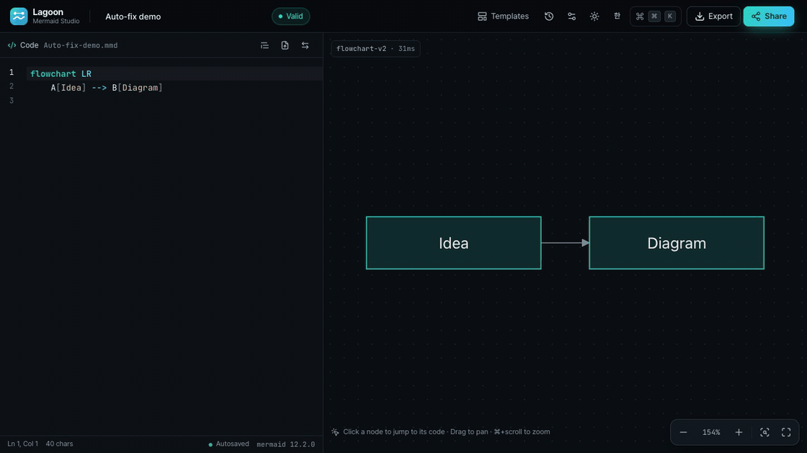
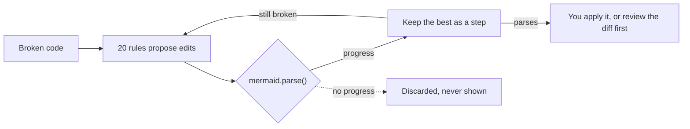
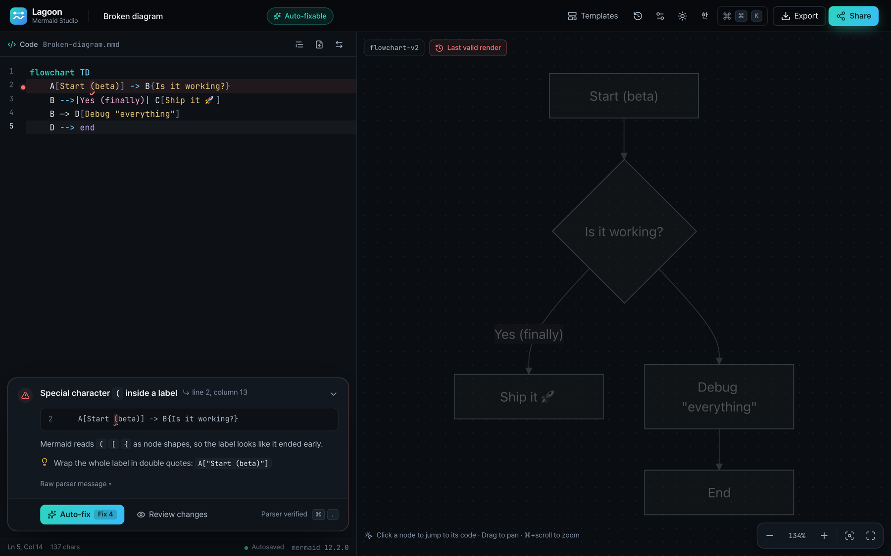
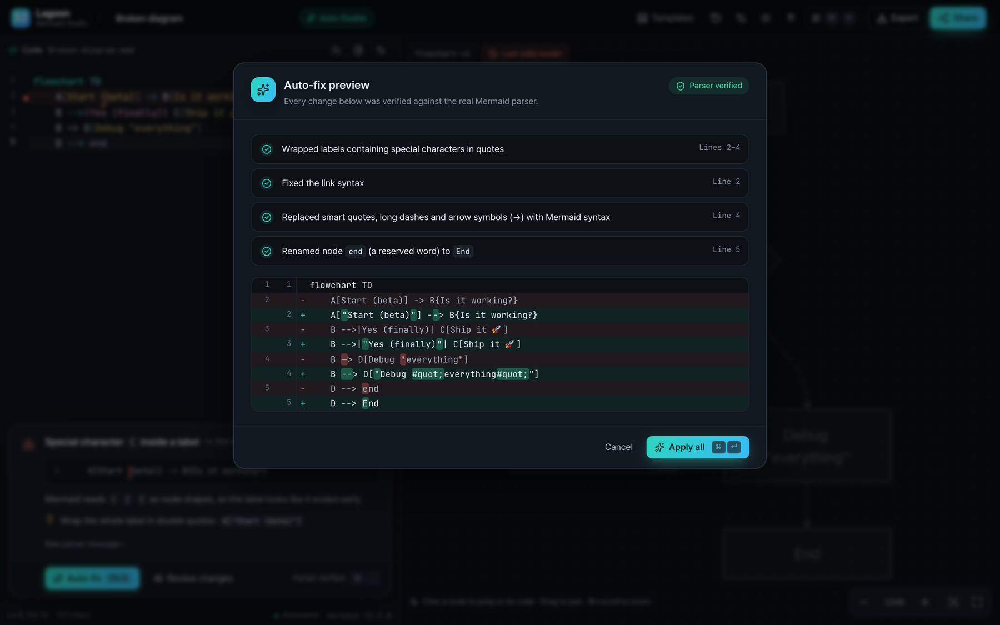
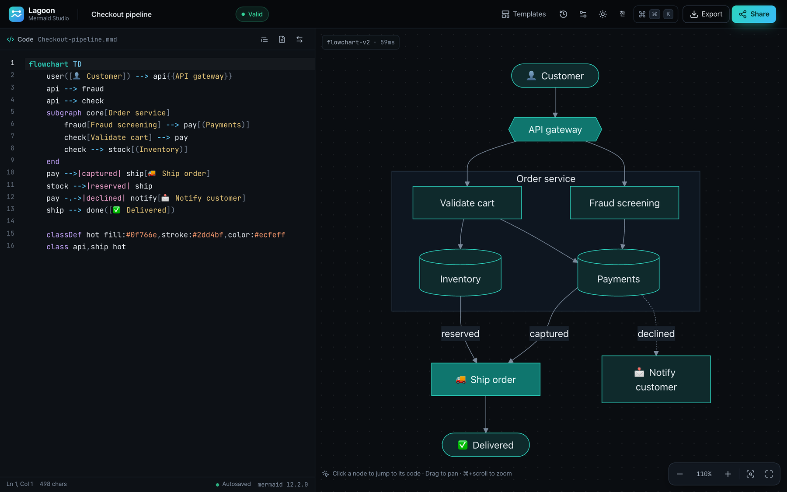

<div align="center">

<a href="https://lagoon-mermaid.vercel.app"></a>

### Paste broken Mermaid. Get a diagram that renders.

Plain-language errors and one-click fixes, each one checked by the real Mermaid parser.<br>No account, no API key, and your diagram never leaves your browser.

**[Try it live →](https://lagoon-mermaid.vercel.app)** &nbsp;&nbsp;·&nbsp;&nbsp; **[How auto-fix works](#how-auto-fix-works)** &nbsp;&nbsp;·&nbsp;&nbsp; **[What it repairs](#what-it-repairs)** &nbsp;&nbsp;·&nbsp;&nbsp; **[한국어](README.ko.md)**

[](https://lagoon-mermaid.vercel.app) [](https://github.com/mermaid-js/mermaid) <br>  

<br>

<a href="https://lagoon-mermaid.vercel.app"> and —> arrows and an end node is pasted in. An error card appears over the dimmed last render, Auto-fix · Fix 6 is clicked, the diagram renders with the toast Fixed 6 issues · ⌘Z, and clicking a node lights up its line of code."></a>

<sub>Paste a broken diagram &nbsp;→&nbsp; read what's wrong &nbsp;→&nbsp; <b>Auto-fix · Fix 6</b> &nbsp;→&nbsp; <i>Fixed 6 issues · ⌘Z</i> &nbsp;→&nbsp; click a node, land on its line</sub>

</div>

<br>

## How auto-fix works

This is the diagram from the demo, exactly as it was pasted. One click fixes all six issues:

````diff
- ```mermaid
- graph TOP
+ graph TD
-     A[Start (beta)] -> B{Is it working?}
+     A["Start (beta)"] --> B{Is it working?}
-     B -->|Yes (finally)| C[Ship it 🚀]
+     B -->|"Yes (finally)"| C[Ship it 🚀]
-     B —> D[Debug "everything"]
+     B --> D["Debug #quot;everything#quot;"]
-     D --> end
+     D --> End
- ```
````

<sub>Yes, the inner quotes become <code>#quot;</code>. That is Mermaid's own escape, and the label still reads <i>Debug "everything"</i>.</sub>

There is no model and no guessing. **Rules propose, the parser decides, you approve.** Every candidate edit is re-parsed by the same `mermaid.parse()` that renders your diagram, and it survives only if the error is gone or the parser got further into the file.



### Watch the error walk down the file

Each row is one accepted step, followed by what `mermaid.parse()` reported next. The error moves further down the file at every step until there is none left. (Line numbers count the code at that step, so after step 1 the fence line is gone.)

| Step | Rule | Edit | Parser says next |
|:-:|---|---|---|
| | | *as pasted* | ✗ line 1 · Markdown code fence detected |
| 1 | `fences` | drop both `` ``` `` lines | ✗ line 1, col 6 · Unsupported direction `TOP` |
| 2 | `direction` | `TOP` → `TD` | ✗ line 2, col 13 · Special character `(` inside a label |
| 3 | `quote-labels` | quote 3 labels with `(` `)` or `"` | ✗ line 2, col 23 · Invalid link |
| 4 | `arrows` | `->` → `-->` | ✗ line 4, col 7 · Unrecognized character |
| 5 | `typography` | em dash `—>` → `-->` | ✗ line 5, col 11 · `end` is a reserved word |
| 6 | `reserved-end` | `end` → `End` | ✓ parses |

<details>
<summary><b>How "the parser got further" is measured</b></summary>

<br>

- **Distance from the end.** The score is how much of the document is still unparsed after the error: the lines below it, then the rest of its own line (`remainingAfter()` in `engine.ts`). Because it is measured from the end, inserting text *before* the error (adding quotes, deleting a fence line) doesn't count as progress by itself.
- **Unterminated constructs.** When something left open swallowed the rest of the file and the parser hit the end of input, closing it counts as progress, even if that surfaces an earlier error.
- **No repeats.** A candidate the engine has already parsed is never parsed again.
- **Bounded.** A run takes at most `max(12, line count)` steps and 2.5 s. In the app the search starts 400 ms after an error appears, and an `AbortController` cancels it the moment you type again.

</details>

### What it will never do

- **Show you a guess.** Every step in the preview has passed `mermaid.parse()`. If the rules or the time budget run out before the diagram parses, the preview says *Some errors remain* instead of *Parser verified*, and the error card says *Partially fixable*.
- **Reword your text.** Rules fix syntax, not words. Text inside labels, strings, comments and frontmatter is never reworded. At most a label gets wrapped in quotes, and an inner `"` becomes `#quot;`, which renders as the same character.
- **Touch a valid diagram.** Auto-fix runs only when parsing fails, and a test asserts that a diagram that already parses comes back unchanged.
- **Drop a line quietly.** When no rule can make progress (`A — B` has a bare dash and no arrowhead to infer), the last resort comments the line out. That step is flagged in the warning colour with a note to double-check it, so you always know.
- **Change anything without you.** Click **Auto-fix** or press <kbd>⌘</kbd> <kbd>.</kbd> to apply, or open **Review changes** to see the exact diff first. One <kbd>⌘</kbd> <kbd>Z</kbd> undoes the whole fix.

## What it repairs

Twenty rules, each one aimed at one kind of mistake, across flowchart, sequence, class, ER, gantt, pie, gitGraph, quadrant and more. Every pair below is real engine output, checked against the parser.

| Mistake | You wrote | Lagoon proposes |
|---|---|---|
| Pasted with Markdown fences | `` ```mermaid `` … `` ``` `` | the diagram without the fences |
| `(` `[` `{` inside a label | `A[Start (beta)]` | `A["Start (beta)"]` |
| `"` inside a label | `D[Debug "everything"]` | `D["Debug #quot;everything#quot;"]` |
| `end` as a node name | `D --> end` | `D --> End` |
| Arrows from other tools | `A -> B` · `A => B` · `A ..> B` | `A --> B` · `A ==> B` · `A -.-> B` |
| Autocorrected arrows | `A → B` · `A —> B` | `A --> B` |
| Invalid direction | `graph TOP` · `graph lr` | `graph TD` · `graph LR` |
| Misspelled or glued header | `flowchar TD` · `graphTD` | `flowchart TD` · `graph TD` |
| Spaces in a subgraph title | `subgraph Back end` | `subgraph Back_end["Back end"]` |
| Spaces in a node name | `My Node --> B` | `My_Node["My Node"] --> B` |
| Unclosed bracket | `A[hello --> B` | `A[hello] --> B` |
| Missing `:` in a message | `Alice ->> Bob hello` | `Alice ->> Bob: hello` |

<details>
<summary><b>Thirteen more, across sequence, class, ER, gantt, quadrant, pie and gitGraph</b></summary>

<br>

| Mistake | You wrote | Lagoon proposes |
|---|---|---|
| `//` or `#` comments | `// note` · `# note` | `%% note` |
| HTML entities from copy-paste | `A --&gt; B` | `A --> B` |
| No diagram header at all | `A --> B` | `flowchart TD` added on top |
| Nested blocks never closed | `subgraph one` › `subgraph two` › end of file | both `end`s, at the right indentation |
| `;` inside a sequence message | `Alice->>Bob: hi; there` | `Alice->>Bob: hi#59; there` |
| Note without `of` | `Note right A: hi` | `Note right of A: hi` |
| Generics in angle brackets | `A <\|-- B<T>` | `A <\|-- B~T~` |
| ER relation without a label | `CUSTOMER \|\|--o{ ORDER` | `CUSTOMER \|\|--o{ ORDER : ""` |
| Gantt task without `:` | `Task one 2024-01-01, 3d` | `Task one : 2024-01-01, 3d` |
| Quadrant point without brackets | `Point A: 0.3, 0.6` | `Point A: [0.3, 0.6]` |
| Token a Langium parser expected | `"Dogs" 386` (pie) | `"Dogs": 386` |
| Keyword typos | `participantt A` · `branchh dev` | `participant A` · `branch dev` |
| Invisible characters | a zero-width space (`U+200B`) after `B` | removed |

When a node name with spaces is renamed (`My Node` → `My_Node`), its references in `style`, `class` and `click` lines are renamed too.

**All 20 rules, in the order they are tried:**
`fences` · `invisible` · `typography` · `entities` · `comments` · `header` · `direction` · `quote-labels` · `subgraph-title` · `reserved-end` · `arrows` · `missing-end` · `unclosed` · `missing-colon` · `insert-expected` · `seq-semicolon` · `note-side` · `class-generics` · `keyword-typo` · `spaced-ids`
and one last resort, `comment-out`, which is always flagged.

</details>

## Errors you can actually read

Here is what `mermaid.parse()` throws for the diagram in the screenshots below:

```text
Parse error on line 2:
...hart TD    A[Start (beta)] -> B{Is it w
----------------------^
Expecting 'SQE', 'DOUBLECIRCLEEND', 'PE', '-)', 'STADIUMEND', 'SUBROUTINEEND', 'PIPE', 'CYLINDEREND', 'DIAMOND_STOP', 'TAGEND', 'TRAPEND', 'INVTRAPEND', 'UNICODE_TEXT', 'TEXT', 'TAGSTART', got 'PS'
```

And here is what Lagoon tells you about the same code:

> **Special character `(` inside a label** &nbsp;·&nbsp; line 2, column 13
>
> Mermaid reads `(` `[` `{` as node shapes, so the label looks like it ended early.
>
> Wrap the whole label in double quotes: `A["Start (beta)"]`

<p align="center">
  
  
</p>
<p align="center"><sub>The error in plain words, with the last valid render waiting dimmed &nbsp;→&nbsp; <b>Review changes</b>: every step verified, every character highlighted, nothing applied until you say so</sub></p>

- **One error shape for both parser families.** Mermaid uses jison (flowchart, sequence, class, state, ER, gantt, journey…) and Langium (pie, gitGraph, packet, architecture, radar…). Lagoon turns errors from either into a line, a column and what was expected there, in English or Korean.
- **Line numbers that match your editor**, even past frontmatter, `%%{init}%%` directives and `%%` comments.
- **Named causes**, such as *`end` is a reserved word*, *Invalid message arrow*, *Unsupported direction `TOP`*, or an invisible character named by its code point (`U+200B`). Each one gets a squiggle and a gutter dot in the editor.

## Why it's different

| What you get | Why you can count on it |
|---|---|
| **No account** | Open the page and paste. There is nothing to sign up for. |
| **No API key** | Fixes come from deterministic rules running in your tab. No AI service, no model. |
| **Your diagram stays with you** | There is no backend. Autosave and history are local, and share links keep the diagram in the URL hash, which browsers never send to a server. |
| **Parser-verified** | A fix appears only after the real `mermaid.parse()` accepts it. |

<sub>For context: the official editor at mermaid.live offers AI Repair once you create a free account (checked October 19, 2026). Lagoon takes the other route: rules plus the parser, all on your machine. It even opens mermaid.live share links, because the <code>#pako:</code> hash format is the same.</sub>

## Features

<p align="center">
  
  
</p>
<p align="center"><sub>Dark or light. The signature Lagoon diagram theme follows the app.</sub></p>


**Write**

- **Live preview.** Re-renders about 160 ms after you stop typing. When the code breaks, the last valid render stays on screen, dimmed.
- **An editor that knows Mermaid.** CodeMirror 6 with Mermaid highlighting, autocomplete, inline squiggles and gutter dots.
- **Drop a file in.** `.mmd`, `.md` or `.txt`. The mermaid block is pulled out for you.

**See**

- **Click a node, land on its code.** The line flashes and the token is selected.
- **A real canvas.** Drag or use the trackpad to pan, zoom with <kbd>⌘</kbd>/<kbd>Ctrl</kbd> + scroll, a pinch or the mouse wheel, double-click to fit, and go fullscreen.
- **Make it yours.** The Lagoon theme, or mermaid's default, neutral, dark, forest and base. Classic or hand-drawn look, dagre or ELK layout, curve style, raw JSON config.
- **Fixes on top of mermaid.** Labels on edges attached to a subgraph snap back onto their line, and Korean and other CJK labels wrap between words, not mid-word. Both are baked into the SVG, so exports match the preview.

**Ship**

- **Export anything.** PNG (2×, 4×, transparent), SVG, image to clipboard, SVG code, a Markdown mermaid block, or `.mmd`. Korean text and emoji come through intact.
- **Share with a link.** The whole diagram rides in the URL hash (`#pako:`). A shared link can't loosen security settings (`securityLevel` stays `strict`), and opening one checkpoints your current work first.
- **Never lose work.** Autosave plus version history, all local.
- **Fits your setup.** Korean and English UI (auto-detected), light and dark, a phone layout with Code and Preview tabs. It runs on Safari before 16.4 too.

<br clear="right">

## Shortcuts

| Keys | Action |
|---|---|
| <kbd>⌘</kbd> <kbd>K</kbd> | Command palette |
| <kbd>⌘</kbd> <kbd>.</kbd> | Apply auto-fix |
| <kbd>⌘</kbd> <kbd>↵</kbd> | Apply all (in the auto-fix review) |
| <kbd>⌘</kbd> <kbd>S</kbd> | Save a version to history |
| <kbd>⌘</kbd> <kbd>⇧</kbd> <kbd>F</kbd> | Tidy indentation |
| <kbd>⌘</kbd> <kbd>Z</kbd> | Undo, including a whole auto-fix |
| <kbd>+</kbd> &nbsp;<kbd>-</kbd> &nbsp;<kbd>0</kbd> | Zoom in, zoom out, fit (when the editor isn't focused) |

<sub>On Windows and Linux, use <kbd>Ctrl</kbd> instead of <kbd>⌘</kbd>.</sub>

## Supported diagrams

Lagoon draws with mermaid 12.2.0 itself, not a reimplementation. These 22 ship as templates with live thumbnails, and the test suite checks that every one of them parses:

<p align="center">
  
</p>

Flowchart · Sequence · Class · State · Entity Relationship · Gantt · Pie · Mindmap · Timeline · Git graph · User journey · Quadrant · XY chart · Sankey · Block · Architecture · Kanban · Packet · C4 context · Requirement · Radar · Treemap

There is also a deliberately broken diagram, for when you just want to watch auto-fix work.

## Run it locally

```bash
pnpm install
pnpm dev      # http://localhost:5173
pnpm test     # 210 tests, run against the real mermaid parser
pnpm build
```

Built with Vite 8, React 19, TypeScript 7, CodeMirror 6, Tailwind CSS 4 and mermaid 12.2.0. Mermaid is lazy-loaded, so the main bundle doesn't include it. The app deploys as a static site on Vercel.

<details>
<summary><b>What the tests cover</b></summary>

<br>

There are 210 tests in 13 files (vitest + jsdom), and they run against the real mermaid parser:

- 40+ broken → fixed cases
- every template must parse
- valid diagrams must never be modified by auto-fix
- explanations in both languages, plus i18n key coverage
- share-link safety, history, and safe editor remounts
- no regex lookbehind in the shipped bundle, which keeps Safari before 16.4 working

Before release, an independent multi-agent review tried to break Lagoon. All 38 findings were fixed and verified again.

</details>

<details>
<summary><b>Where things live</b></summary>

<br>

```text
src/
├── lib/
│   ├── diagnose.ts        any mermaid error → one Diagnostic, mapped to your lines
│   ├── explain.ts         Diagnostic → title, detail and hint, in English or Korean
│   ├── fix/
│   │   ├── engine.ts      propose → re-parse → keep progress
│   │   ├── rules.ts       the 20 rules and the last resort
│   │   └── text.ts        label/string/comment masking, line helpers
│   ├── mermaid.ts         lazy loader, Lagoon theme, rendering fixes
│   ├── share.ts           #pako: links and their safety limits
│   └── storage.ts         autosave and history
├── hooks/useDiagram.ts    debounced render and the background fix search
├── editor/                CodeMirror language, highlighting and autocomplete
└── components/            ErrorDock, FixSheet, DiffView, Preview, …
```

</details>

<br>

<div align="center">

<a href="https://lagoon-mermaid.vercel.app"></a>

**[Open Lagoon →](https://lagoon-mermaid.vercel.app)**

<sub>Your next broken diagram is one paste away from working.<br>If Lagoon saves you a debugging session, a ⭐ helps other people find it.</sub>

</div>
